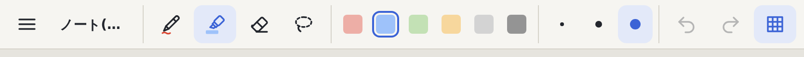

# ペンとマーカーのアイコンを、形と今の色で見分けられるようにする

status は proposed: 良し悪しは nishio が iPad で見て決める。**実機では未確認。**

## 経緯

nishio「ペンとマーカーのアイコンが微妙」(2026-11-06、[raw](../../raw/2026-11-06_iPadで使った感想_パームのundo_fit_アイコン_題名.md))。前のアイコンは、どちらも斜めの細い軸の筆記具で、マーカーは下に線が 1 本あるだけだった。24px では形の違いがほとんど無い。何が「微妙」なのか(見分けにくい、形が悪い、など)は聞いていない。見分けやすさを優先して描き直した。

## 決めたこと

- **ペン**: 細い軸と尖ったペン先。その下に、**今のペンの色**で書いた細い波線。
- **マーカー**: 太い軸と斜めに切ったペン先(キャップの段つき)。その下に、**今のマーカーの色**で塗った太い帯。
- 違いを 3 つ重ねた: 軸の太さ、線の太さ(細い線 / 太い帯)、色(ペンの色 / マーカーの淡い色)。どれか 1 つが小さくて見えなくても、残りで分かるように。
- 色は CSS 変数(`--pen`、`--mk`)で、道具の状態を UI に反映する `syncTools` が設定する。消しゴム・投げ縄は変えていない。マーカーの軸が消しゴムの四角に似ないよう、軸を細長くした(ヘッドレスの WebKit で 4 つ並べて確かめた)。

## 捨てた案

| 案 | 捨てた理由 |
|---|---|
| 形だけを描き分ける(色を使わない) | 24px で線幅 1.7 では、形の違いだけだと前と同じく見分けにくい |
| アイコン全体を今の色で塗る | 薄いマーカーの色(薄い灰など)が道具バーの地に溶ける。選択中の青い表示とも混ざる |
| 文字(「ペン」「マーカー」)を添える | 道具バーが iPad の縦向きで既に横に詰まっている |

## 見直す条件

nishio が iPad で見て、まだ見分けにくい・形が気に入らないと言ったら描き直す。見本(好きなアイコンや Notability のもの)があれば、それに寄せる。

## Sources

- [raw/2026-11-06_iPadで使った感想_パームのundo_fit_アイコン_題名.md](../../raw/2026-11-06_iPadで使った感想_パームのundo_fit_アイコン_題名.md)
- [index.html](../../index.html)(`data-tool="pen"`、`data-tool="marker"`)、[src/style.css](../../src/style.css)(`.ink`、`.swath`)、[src/main.ts](../../src/main.ts)(`syncTools`)
